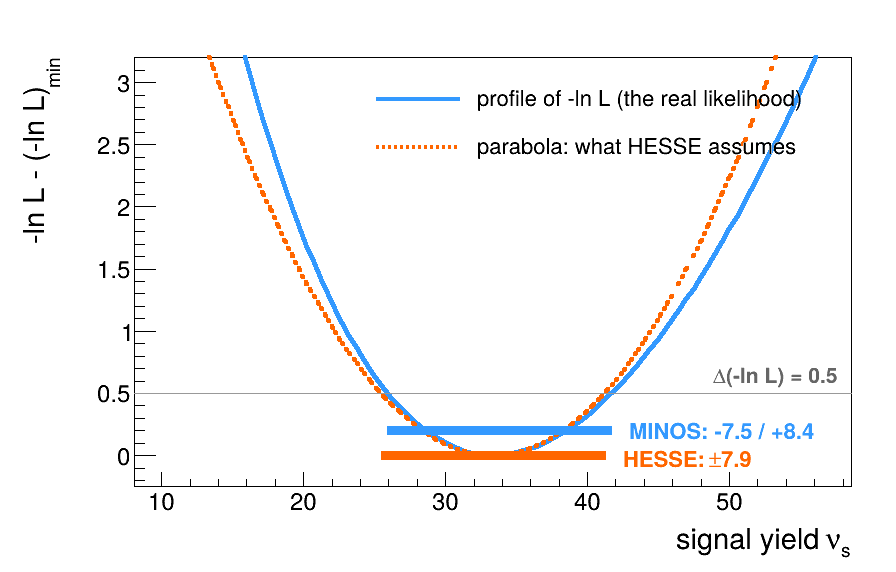
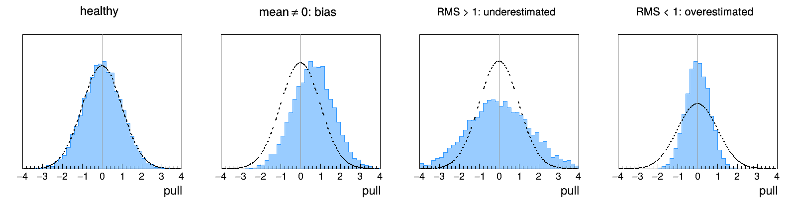
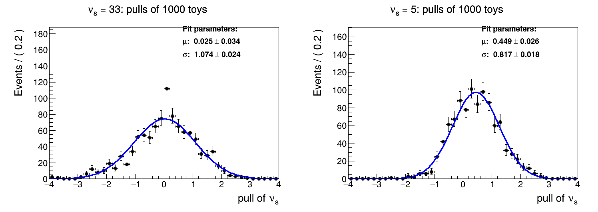

<!-- _class: lead -->
<!-- _paginate: false -->
# Lab 2 — Likelihood and fit quality
**Statistical Data Analysis for Nuclear and Subnuclear Physics — Module 3**
G. Sirri · Hands-on sessions, 9:00–13:00

---

# Recap (5 minutes)

Discuss in pairs, then we compare:

1. In the marked Poisson model, which factor is the **rate** and which the **shape**? What is a **channel**, and what is a **component**?
2. Extended fit vs fit with fractions: what information is lost with fractions?
3. A binned likelihood is **not** a $\chi^2$ fit. Why does it matter for low counts?
4. Which two Lab 1 notebooks did you submit? Which cell was the hardest?

---

# Recap: answers

1. $P=\text{Pois}(n\,|\,\nu)\prod_i f(x_i)$: the **rate** is the Poisson term (how many events), the **shape** is the product of the pdfs (where they are). A **channel** is a subset of the data, selected with a criterion. A **component** is the part of the model for one physics process
2. With **fractions** the total $n$ is **not used**: one parameter fewer ($\phi$ instead of $\nu_s$ and $\nu_b$)
3. A $\chi^2$ fit assumes Gaussian counts. With few counts, or empty bins, the **Poisson likelihood is exact**
4. The hardest cells: we open them in the solutions, next

---

# Solutions of Lab 1 (15 minutes)

The solutions are in the `solutions` branch: [`solutions/lab1/`](../../solutions/lab1), from today.

- **[A](../../solutions/lab1/ex_A_solution.ipynb)**: the Gaussian fit and the **ranges** of a parameter and of an observable (A1, A3)
- **[B](../../solutions/lab1/ex_B_solution.ipynb)**: the **binned** Breit–Wigner fit and the central limit theorem (B1, B2)
- **[C](../../solutions/lab1/ex_C_solution.ipynb)**: **extended** and **shape-only** fits, and the number of free parameters (C1, C2)

---

# Today's schedule

| Time | |
|---|---|
| 9:00 | Recap and Lab 1 questions |
| 9:20 | Talk A: what happens in `fitTo` |
| 9:40 | Hands-on A: anatomy of a fit |
| 10:25 | **Break (15 min)** |
| 10:40 | Talk B: likelihood intervals, nuisance parameters |
| 11:00 | Hands-on B: the on/off problem |
| 11:45 | **Break (10 min)** |
| 11:55 | Talk C: residuals, pulls and Toy MC |
| 12:10 | Hands-on C: pulls, bias, coverage |
| 12:35 | Open lab: finish a notebook, ask questions |
| 12:55 | Wrap-up |

---

<!-- _class: lead -->
# Talk A
## What happens in `fitTo`

---

# What happens in `fitTo`

`pdf.fitTo(data)` is a convenient wrapper. Under the hood, it does four things:

1. Builds the **negative log-likelihood** $-\ln L(\theta)$ (a function of the parameters)
2. Minimises it with **MIGRAD** (the gradient-descent algorithm of MINUIT).
3. Computes the covariance matrix with **HESSE** (second derivatives).
4. (On request) computes asymmetric errors with **MINOS**.

$$-\ln L(\theta) = -\sum_i \ln f(x_i\,|\,\theta) \;\;[+\,\nu(\theta)\;\text{ if extended}]$$

Today we open the box and call each step ourselves, with `RooMinimizer`.

*More: [why MINUIT, and the risks of another minimiser](./lab2_backup.md)*

---

# MIGRAD, HESSE, MINOS

Three algorithms of **MINUIT**, the minimisation library of ROOT:

| Step | What it does | Output |
|---|---|---|
| **MIGRAD** | follows the gradient to the minimum (variable metric) | best-fit values, **EDM** (Estimated Distance to Minimum).|
| **HESSE** | second derivatives at the minimum: $V = H^{-1}$, $H_{ij}=\partial^2(-\ln L)/\partial\theta_i\partial\theta_j$ | symmetric errors, correlations |
| **MINOS** | scans $-\ln L$ until it rises by 0.5 for each parameter | asymmetric errors |

- HESSE assumes the likelihood is a **parabola** near the minimum
- MINOS makes no such assumption, but costs more fits
- If HESSE and MINOS disagree, the likelihood is not parabolic: **trust MINOS, and say so**

*More: [Hesse and Minos](https://scikit-hep.org/iminuit/notebooks/hesse_and_minos.html)*

---

# Seeing the likelihood: HESSE and MINOS

- **HESSE**: the parabola with the **same curvature** at the minimum: a symmetric error
- **MINOS**: where the **real** curve rises by 0.5: it can be asymmetric. **Trust MINOS when they differ**
- To draw the curve we **scan** one parameter, with the others fixed (*slice*) or re-fitted (*profile*): Talk B explains the difference. In Exercise A you see both

---

# Is my fit healthy?

Always check:

| Quantity | Healthy value |
|---|---|
| `status()` | 0 |
| `covQual()` | 3 (full, accurate covariance) |
| EDM (estimated distance to minimum) | tiny |
| parameters at a limit? | none |
| correlation coefficients | no $\lvert\rho\rvert\approx 1$ |

A parameter stuck at its **limit** is a warning, not a result.

---

# When fits go wrong — Debug Flowchart (1/2)

When a fit fails, follow this checklist in order:

1. **Does not converge** (MIGRAD does not find the minimum)
   - Parameter ranges too wide? Initial values too far from the likelihood minimum? 
   - *Fix*: `setRange()` narrower, `setVal()` to reasonable value.

2. **Converges but huge errors or correlation $\lvert\rho\rvert\approx 1$**
   - Parameters are degenerate (the fit cannot distinguish them).
   - *Fix*: fix one of the two parameters, or reformulate the model.

---

# When fits go wrong — Debug Flowchart (2/2)

3. **Converges but a parameter is at the limit** (e.g., fraction = 0 or 1)
   - Physical limit is too tight, or the model is wrong.
   - *Fix*: widen the range if it makes sense, or reparametrize (e.g., fit `ln(τ)` instead of `τ`).

4. **Works only on some toys**
   - Low statistics → likelihood is not parabolic.
   - *Fix*: use MINOS, or switch to Neyman intervals (Lab 3).

---   

<!-- _class: lead -->
# Hands-on A
## Anatomy of a fit

---

# Exercise A (≈ 45 min)

Same data and model as Lab 1, Exercise C (LHCb, signal + background).

1. Build the NLL, run **MIGRAD** and **HESSE** by hand with `RooMinimizer`. Read status, EDM, `covQual`
2. Get the **MINOS** errors on `nsig`. Are they symmetric? Same as HESSE?
3. Print the **correlation matrix**. Which pair is most correlated, and why?
4. Plot the NLL scan in `nsig`, the **profile** NLL and the **HESSE parabola** together
5. Draw the 1σ and 2σ **contour** of (`nsig`, `nbkg`)

We write step 1 **together**, live (5 min), then you continue.
Notebook: [`course/lab2/ex_A.ipynb`](../lab2/ex_A.ipynb)

---

### Key Takeaways from Hands-on A

**Statistics**
- **HESSE** is a parabola at the minimum. **MINOS** follows the real curve: if they differ, **trust MINOS**
- A **scan** of $-\ln L$ keeps the other parameters fixed (*slice*) or re-fits them (*profile*): Talk B
- A contour shows the **correlation**: $\lvert\rho\rvert\approx 1$ means degenerate parameters

**RooFit**
- `fitTo()` = NLL → `RooMinimizer`: `.migrad()`, `.hesse()`, `.minos()`. After a fit, `var.getVal()` and `var.getError()` hold the result
- `nll.createProfile(poi)` and `minimizer.contour(v1, v2, 1, 2)`: run **`hesse()` right before** the contour
- `plotOn(frame, Components("bkg"), LineStyle(kDashed))` draws one component
---

<!-- _class: lead -->
# Talk B
## Likelihood intervals and nuisance parameters

---

# Likelihood-ratio intervals

For **one** parameter $\mu$ (Wilks' theorem, large samples):

$$-2\ln\frac{L(\mu)}{L(\hat\mu)} \;\sim\; \chi^2_1$$

| Confidence level | $\Delta(-\ln L)$ | $-2\Delta\ln L$ |
|---|---|---|
| 68.3 % | 0.5 | 1 |
| 90% | 1.36 | 2.71 |
| 95 % | 1.92 | 3.84 |

The interval is where the NLL curve $ -\ln L $ is below the minimum **+ 0.5**.
It need not be symmetric: this is the **MINOS interval** (see the figure of Talk A).

---

# Nuisance parameters

A model has **parameters of interest** $\mu$ and **nuisance parameters** $\theta$ (background rate, resolution, efficiency…).

Two ways to draw the likelihood in $\mu$:

- **Slice**: fix $\theta$ at its best-fit value → too optimistic, ignores uncertainty
- **Profile**: for every $\mu$, re-fit $\theta$ → correct frequentist coverage.

$$\lambda(\mu)=\frac{L\big(\mu,\hat{\hat\theta}(\mu)\big)}{L(\hat\mu,\hat\theta)}, \qquad q(\mu) = -2\ln\lambda(\mu)$$

The profile curve is **wider** than the slice. The gap is the cost of the nuisance parameter.

---

# Signal region / control region (the classic on/off problem)

Counting experiment with an **auxiliary measurement** of the background:

$$L(s,b) = \text{Pois}(n_{\rm on}\,|\,s+b)\;\times\;\text{Pois}(n_{\rm off}\,|\,\tau b)$$

- $n_{\rm on}$: events in the signal region; $n_{\rm off}$: events in the control region
- $\tau$: ratio of control to signal exposure (size of the control region)
- Best fit: $\hat b = n_{\rm off}/\tau$, $\hat s = n_{\rm on}-\hat b$
- The uncertainty on $b$ is **not an input**: it comes from the control region

This is the model behind “background $3.8\pm0.6$”. Constraint terms in Lab 3.

*Note: The same concept extends naturally to shape analyses: control regions become additional channels that constrain nuisance parameters through a simultaneous likelihood fit.*

---

<!-- _class: lead -->
# Hands-on B
## The on/off problem

---

# Exercise B (≈ 45 min)

Counting experiment: $n_{\rm on}=17$, $n_{\rm off}=40$, $\tau=10.53$ (top-quark case).

1. Build the model with two `RooPoisson` and fit: $\hat s$, $\hat b$
2. Compute the 68 % interval on $s$ from the **profile** NLL, and with **MINOS**. Compare
3. Compare with the **slice** at $b=\hat b$
4. Repeat with a poorer control region: $n_{\rm off}=4$, $\tau=1.053$ (same $\hat b$). What changes?

We write the model of step 1 **together**, live (5 min), then you continue.
Notebook: [`course/lab2/ex_B.ipynb`](../lab2/ex_B.ipynb)

---

### Key Takeaways from Hands-on B

**Statistics**
- A **slice** fixes the nuisance parameters, a **profile** re-fits them: the profile is wider. **MINOS is the profile scan**: they must match
- The uncertainty on $b$ **comes from the control region** ($\tau$): a poorer control region widens the interval

**RooFit**
- The on/off model: `RooFormulaVar` for $s+b$ and $\tau b$, two `RooPoisson`, and a `RooProdPdf`
- `nll.createProfile(poi)` draws the profile; `RooMinimizer` gives HESSE and MINOS
---

<!-- _class: lead -->
# Talk C
## Toy MC and pulls

---

# Testing the fit with Toy MC

HESSE and MINOS errors are **approximations**: they assume a likelihood close to a parabola. Is it true for **my** model, with **my** statistics? A toy study answers:

1. **Generate** a dataset from the model, with **known true** parameters
2. **Fit** it, exactly as you fit the data
3. **Record** the fitted values and their errors
4. **Repeat** 300–1000 times, and look at the **distribution** of the results

In RooFit, the class **`RooMCStudy`** runs this loop for you.

---

# The pull

For each toy, compare the fit with the truth, **in units of the error that the fit quotes**:

$$\text{pull} = \frac{\hat{\theta} - \theta_{\text{true}}}{\hat{\sigma}_{\theta}}$$

- **numerator**: how far the fit is from the truth
- **denominator**: how large the fit *says* its error is
- If $\hat\theta$ is unbiased and $\hat\sigma_\theta$ is its true spread, the pulls of the toys follow a **standard Gaussian** $\mathcal{N}(0,1)$

The pull is **one number per toy**: we need many toys to see its distribution.

---

# What to look at in the pull distribution

| Look at | Healthy | If not |
|---|---|---|
| **Mean** | $\approx 0$ | $\neq 0$: **bias** of the estimator ($+0.4$: on average $0.4\,\sigma$ above the truth) |
| **RMS** | $\approx 1$ | $>1$: **the uncertainty is underestimated** (the fit is too optimistic). $<1$: overestimated (too conservative) |
| **Coverage**: fraction of toys with $\lvert\text{pull}\rvert<1$ | $\approx 68\%$ ($95\%$ for $\lvert\text{pull}\rvert<2$) | smaller: errors too small. Larger: errors too large |
| **Shape** | Gaussian | skewed or with tails: the likelihood is **not a parabola** |
| **Failed fits** | none | count them: they are information about the model |

---

# Four typical pull distributions

**RMS larger than 1: the quoted uncertainty is smaller than the real spread.**

---

# Low statistics: the problem, the symptom, the way out

- **The problem**: with few events the likelihood is **not a parabola**, and parameters hit **boundaries** ($\nu_s\ge0$). HESSE assumes a parabola, so its error is not reliable
- **The symptom**: the **pulls** (Exercise C): mean $\neq0$, RMS $\neq1$, a skewed shape, failed fits
- **The way out**: **MINOS or profile** intervals follow the real curve (Talks A and B). For exact coverage, a Neyman construction with toys (Lab 3)

Toys that fail to converge are not "missing": they are information about the model.
---

# A note: residuals are not pulls

The formulas look alike, but they answer different questions:

- **Residuals** (observable, one dataset): $(N_{\text{data}}-N_{\text{model}})/\sigma_{\text{model}}$, bin by bin. Is the **shape** of the model good?
- **Pulls** (parameters, many toys): $(\hat\theta-\theta_{\text{true}})/\hat\sigma_\theta$. Is the **fitter** good: bias, errors, coverage?
---

<!-- _class: lead -->
# Hands-on C
## Pulls, bias, coverage (with `RooMCStudy`)

---

# Exercise C (≈ 25 min)

**Model:** LHCb signal + background, extended.

Instead of writing a manual Python loop, we will use the native, highly-optimized C++ class **`RooMCStudy`**, which handles generation, fitting, and pull calculation automatically.

1. Set the true values and initialize `RooMCStudy` **(we will write this part together, live, 5 min)**.
2. Run `generateAndFit()` and use the native `plotPull()` method to visualize the results.
3. Check the statistics: Mean $\approx 0$ (no bias), RMS $\approx 1$ (correct error estimation), Coverage $\approx 68\%$.
4. **Stress test:** Repeat the study with a low signal yield ($\nu_s=5$). 
   - *Question:* What happens to the pull distribution? How many fits fail or hit the physical boundary ($\nu_s \ge 0$)?

Notebook: [`course/lab2/ex_C.ipynb`](../lab2/ex_C.ipynb)

---

### Key Takeaways from Hands-on C

**Statistics**
- Read the pulls: **mean** (bias), **RMS** (RMS $>1$: uncertainty underestimated), **coverage** (68%), **shape**
- **Count the failed fits**: they are information about the model

**RooFit**
- **`RooMCStudy`** runs generate and fit, resets the parameters at each toy, and **generates with the current values**: set the truth *before* creating the study
- `plotPull(var, FitGauss(True))` draws the pulls. `fitParDataSet().Print("v")` lists **all the variables** (`nsig`, `nsigerr`, `nsigpull`, ...)
- **Technicality: failed fits = number of toys − number of rows of the dataset**
- One process: for many toys use many jobs, with **different seeds** (backup)
---

# Open lab (20 min)

Work on the notebook you have not finished, or on the third one if you want to see it before the solutions.

- Every notebook of today is **independent**: pick any
- Ask yourself, for each fit: *what would break it?*
- Run the notebook top to bottom: every check must say `PASS`

Ask for help early. I walk around.

---

# Wrap-up and submission (before Lab 3, in 2 weeks)

**Today you learned**
- what `fitTo` does: NLL, MIGRAD, HESSE, MINOS
- profile vs slice, and why nuisance parameters widen intervals
- toys, pulls, bias and coverage

**By Lab 3**
1. Submit **2 of the 3** notebooks of [`lab2/`](../lab2/) (A, B, C: your choice) on **Virtuale**, every check `PASS`
2. We look at the solutions of all three at the beginning of Lab 3
3. Read Cowan, Cranmer, Gross, Vitells, *Asymptotic formulae for likelihood-based tests of new physics* ([arXiv:1007.1727](https://arxiv.org/abs/1007.1727)), Sections 1–2

**Next time:** constraints and auxiliary measurements, RooStats, correlated systematics (a real problem: OPERA).
