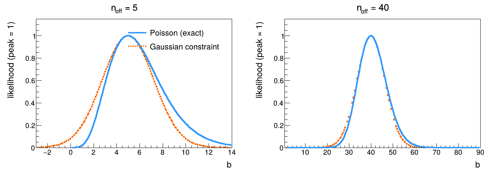

<!-- _class: lead -->
<!-- _paginate: false -->
# Lab 3 — Systematics and inference
**Statistical Data Analysis for Nuclear and Subnuclear Physics — Module 3**
G. Sirri · Hands-on sessions, 9:00–13:00

---

# Recap (5 minutes)

Discuss in pairs, then we compare:

1. Slice vs profile likelihood: which is wider, and why?
2. In the on/off problem, where does the uncertainty on the background come from?
3. What does a pull RMS of 1.3 tell you?
4. Which two Lab 2 notebooks did you submit? Did the toy study run for you?

---

# Recap: answers

1. A **slice** keeps the nuisance parameters fixed. A **profile** re-fits them at every point, so their uncertainty adds: **the profile is wider**
2. From the **control region**: $\sigma_b=\sqrt{n_{\rm off}}/\tau$, the Poisson uncertainty of the control count
3. RMS $>1$: **the uncertainty is underestimated** (1.3 means about 30 % too small)
4. The hardest cells: we open them now

---

# Solutions of Lab 2 (15 minutes)

The solutions are in the `solutions` branch: [`solutions/lab2/`](../../solutions/lab2), from today.

- **[A](../../solutions/lab2/ex_A_solution.ipynb)**: `HESSE`, `MINOS` and the contour (A1, A2, A5)
- **[B](../../solutions/lab2/ex_B_solution.ipynb)**: the on/off model, and the profile interval versus `MINOS` (B1, B2)
- **[C](../../solutions/lab2/ex_C_solution.ipynb)**: the toy study, the pulls and the failed fits (C1, C2)

---

# Today's schedule

| Time | |
|---|---|
| 9:00 | Recap and Lab 2 questions |
| 9:20 | Talk A: constraints vs auxiliary measurements |
| 9:40 | Hands-on A: on/off with a Gaussian constraint |
| 10:20 | **Break (15 min)** |
| 10:35 | Talk B: RooStats, significance, intervals |
| 10:55 | Hands-on B: ModelConfig and hypothesis test |
| 11:35 | **Break (10 min)** |
| 11:45 | Talk C: correlated systematics |
| 12:00 | Hands-on C: a real problem, OPERA |
| 12:40 | Open lab: finish a notebook, ask questions |
| 12:55 | Wrap-up |

---

<!-- _class: lead -->
# Talk A
## Constraints vs auxiliary measurements

---

# Two ways to model a systematic

A nuisance parameter $\theta$ is a quantity needed in the model, known only up to an uncertainty.  
Where does our knowledge of $\theta$ come from?

| | **Auxiliary measurement** | **Constraint term** |
|---|---|---|
| Source of knowledge | a dedicated measurement we perform | an external result (a publication or another group) |
| Concrete case | fitting a sideband or control region | using a quoted value (e.g., “bkg = $3.8 \pm 0.6$”) |
| You need | the control data $n_{\rm off}$ | only the published estimate $\hat{\beta}\pm\sigma_{\hat{\beta}}$ |
| What you write | the likelihood of the control data | a PDF treating $\hat{\beta}$ as a *global observable*, $\hat{\beta} \rightarrow b_0$ |
| Example | $\text{Pois}(n_{\rm off}\,\vert\,\tau \beta)$ | $\text{Gauss}(b_0\,\vert\,\beta,\sigma_{\hat{\beta}})$ |

Both enter the likelihood **as a factor**. The second is an approximation of the first.

---

# From on/off to a Gaussian constraint

The control measurement gives $b_0=n_{\rm off}/\tau$ with $\sigma_{\hat \beta}=\sqrt{n_{\rm off}}/\tau$.

For large $n_{\rm off}$:

$$\text{Pois}(n_{\rm off}\,\vert\,\tau \beta)\;\approx\;\text{Gauss}(b_0\,\vert\,\beta,\sigma_{\hat \beta})$$

- Good for $n_{\rm off}\gtrsim 30$–$50$. 
  Bad for few counts: the Gaussian is symmetric, allows $\beta<0$, and **overstates significance**
- Positive, multiplicative uncertainty (efficiency, luminosity)? use a **log-normal**
- Few Poisson counts? a **Gamma** constraint matches the exact Poisson shape

Rule: **use the measurement when you have it; use a constraint when you only have its result.**

---

---

# The full model, and global observables

$$L(\mu,\vec\theta)=\underbrace{\text{Pois}\big(n\,|\,\nu(\mu,\vec\theta)\big)\prod_{i=1}^{n} f(x_i\,|\,\mu,\vec\theta)}_{\text{extended marked Poisson}}\;\times\;\underbrace{\prod_j c_j(a_j\,|\,\theta_j)}_{\text{constraints}}$$

- $a_j$ = is a proxy for a result of the auxiliary measurement: a **global observable**
- In the **fit**: $a_j$ are constants. In **toys**: $a_j$ are re-thrown with the data (frequentist)
- RooFit: `createNLL(data, GlobalObservables(...))`; 
  RooStats: `ModelConfig.SetGlobalObservables`

---

<!-- _class: lead -->
# Hands-on A
## On/off with a Gaussian constraint

---

# Exercise A (≈ 40 min)

Top-quark case: $n_{\rm on}=17$, $n_{\rm off}=40$, $\tau=10.53$, i.e. “background $3.8\pm0.6$”.

1. Build the model with a **Gaussian constraint** on $b$ (global observable $b_0=3.80$, $\sigma_b=0.60$)
2. Compute the **significance** $Z_0$ for both models (auxiliary Poisson measurement, Gaussian contraint term): they should agree
3. Repeat with a poor control region ($n_{\rm off}=4$, $\tau=1.053$): which model is **too optimistic**?
4. When is it fine to use a constraint?

Notebook: [`course/lab3/ex_A.ipynb`](../lab3/ex_A.ipynb)

---

### Key Takeaways from Hands-on A

**Statistics**
- A **constraint** is the PDF of an external estimate: e.g., $\text{Gauss}(b_0 \mid \beta, \sigma_{\hat{\beta}})$ centered on the true parameter $\beta$. Here $b_0$ is a fixed number (*global observable*), not an event in the dataset.
- A **poor control region** means a **large** uncertainty on $b$, and a **lower** significance

**RooFit**
- `RooGaussian(b0, b, sigma_b)` is the constraint, multiplied by the model with `RooProdPdf`
- `createNLL(data, GlobalObservables(b0))` tells the fit that $b_0$ is a **global observable**, not a free variable (so RooFit randomizes it properly in frequentist toys)
---

<!-- _class: lead -->
# Talk B
## RooStats: significance and intervals

---

# From the model to a statement

Three questions, **one likelihood**:

| Question | Statement | Tool |
|---|---|---|
| how significant is the excess? | $p$-value, $Z$ | hypothesis test ($q_0$) |
| what is $\mu$, with its uncertainty? | interval | profile-likelihood interval |
| nothing seen: how large can $\mu$ be? | upper limit | $\text{CL}_s$ (optional notebook) |

**RooFit** builds the pdf and the likelihood. **RooStats** turns them into these statements: it works on any model, but needs to know what each element **is**.

---

# Roles in RooStats: `ModelConfig`

RooStats needs every element of the model to have a **role**, via a **`ModelConfig`** object:

| Element | In `ModelConfig` |
|---|---|
| the model | `SetPdf` |
| parameter of interest ($\mu$ or $s$) | `SetParametersOfInterest` |
| nuisance parameters ($b$) | `SetNuisanceParameters` |
| observables ($n_{\rm on}$) | `SetObservables` |
| global observables ($b_0$) | `SetGlobalObservables` |

A **calculator** takes `(data, ModelConfig)` and returns the statement: 
`ProfileLikelihoodCalculator` (today), `AsymptoticCalculator`, `FrequentistCalculator` (toys), `HypoTestInverter` (limits).

*The right roles are all RooStats needs: no change to the model.*

---
<!--

---

# Intervals and limits

- **Profile-likelihood interval** (what we used in Lab 2): the $\mu$ where $q(\mu)\le 1$, with $q(\mu)=-2\ln\lambda(\mu)$: the same ratio as $q_0$, with $\mu$ fixed at the tested value
- **Upper limit** when the signal is not seen: $\text{CL}_s$ method, via `HypoTestInverter`
- Asymptotic formulae are fast and good for large samples; **toys** are needed when counts are small

Choose the calculator from the **question**:

| Question | Tool |
|---|---|
| how significant is the excess? | hypothesis test ($q_0$) |
| what is $\mu$ and its uncertainty? | profile-likelihood interval |
| nothing seen, how big can $\mu$ be? | $\text{CL}_s$ upper limit |

---
-->

# One test statistics, two uses

**Profile likelihood ratio** (Lab 2): $\;\lambda(\mu)=\dfrac{L(\mu,\hat{\hat\theta})}{L(\hat\mu,\hat\theta)}$, $\;q(\mu)=-2\ln\lambda(\mu)$

| | Fix $\mu$ at | Result |
|---|---|---|
| **Significance** | $\mu=0$ (background only): $q_0$ | $Z=\sqrt{q_0}$, $p=1-\Phi(Z)$ |
| **Interval** | every $\mu$: $q(\mu)\le 1$ (68 %), $3.84$ (95 %) | $[\mu_{\rm lo},\mu_{\rm hi}]$ |

| Claim | $Z$ | $p$ (one-sided) |
|---|---|---|
| evidence | 3 | $1.3\times10^{-3}$ |
| discovery | 5 | $2.9\times10^{-7}$ |

By Wilks' theorem $q$ is asymptotically $\chi^2$: **fast, but good only for large samples**.   
With few counts use **toys**.

---

# Estimating $Z$ by hand

Background **known** ([Cowan, Cranmer, Gross, Vitells 2011](https://arxiv.org/abs/1007.1727)):

$$Z_A=\sqrt{2\Big[(s+b)\ln\Big(1+\frac{s}{b}\Big)-s\Big]}\;\xrightarrow{s\ll b}\;\frac{s}{\sqrt b}$$

- $s/\sqrt b$ **overstates** $Z$ when $s\gtrsim b$: use it as a guide, never for a result
- $Z_A$ ignores the uncertainty on $b$: RooStats, which profiles $b$, gives a **lower** $Z$
- In Exercise B you compare the three on the top-quark case

---

<!-- _class: lead -->
# Hands-on B
## ModelConfig and hypothesis test

---

# Exercise B (≈ 40 min)

Same top-quark model, now in a **workspace** with a `ModelConfig`.

1. Import the model, define POI, nuisance, observables and global observables
2. 68 % and 95 % **interval** on $s$ with `ProfileLikelihoodCalculator`
3. **Significance** and p-value of the background-only hypothesis
4. Compare with $Z_A$ (background known) and with $s/\sqrt b$. Which is closest to the RooStats result, and why?

Notebook: [`course/lab3/ex_B.ipynb`](../lab3/ex_B.ipynb)

---

### Key Takeaways from Hands-on B

**Statistics**
- A **discovery** is a test of the background-only hypothesis: a **p-value**, expressed in sigma. An **upper limit** is a different question (CL$_s$: see the optional notebook)
- $s/\sqrt b$ is a rough guide. $Z_A$ ignores the uncertainty on $b$

**RooFit and RooStats**
- `RooWorkspace` holds the model and the data. `ModelConfig` gives the **roles**: pdf, parameter of interest, nuisance parameters, observables, global observables
- A **calculator** takes a `ModelConfig`: `ProfileLikelihoodCalculator` gives the **intervals** (B2) and the **p-value** of the background-only hypothesis (B3)
---

<!-- _class: lead -->
# Talk C
## Correlated systematics

---

# Systematics are correlated across channels

A systematic source $k$ (e.g., luminosity, tagging efficiency, background cross section) shifts several channel yields $i$ at once by $v_{ik}$:

$$\beta_i = \beta_{0i} + \sum_k v_{ik}\,\theta_k, \qquad \theta_k \sim \mathcal{N}(0,1)\;\;\text{independent}$$

This induces a **covariance matrix** across channels:

$$\Sigma_{ij} = \text{cov}(\beta_i, \beta_j) = \sum_k v_{ik}\,v_{jk}$$

- **Uncorrelated errors** per channel $\rightarrow$ $\Sigma$ is **diagonal** ($\Sigma_{ij} = 0$ for $i \neq j$)
- **Shared sources** $\rightarrow$ off-diagonal terms $\Sigma_{ij} \neq 0$; ignoring them distorts both the uncertainty on $\mu$ and the significance $Z_0$

---

# A 2-channel example: two ways to write the same model

Suppose 2 channels have nominal yields $\beta_{01}, \beta_{02}$ and a **single common** $10\%$ uncertainty ($\rho = 1$):

$$\Sigma = \begin{pmatrix} \sigma_1^2 & \sigma_1\sigma_2 \\ \sigma_1\sigma_2 & \sigma_2^2 \end{pmatrix} \qquad (\det \Sigma = 0 \implies \text{rank } 1)$$

- **Naive way (hard):** use 2 correlated parameters $(\beta_1, \beta_2)$ with a 2D Gaussian $\mathcal{N}_2(\vec{b}_0 \mid \vec{\beta}, \Sigma)$ — fails here because $\Sigma$ is singular!
- **Smart way (standard HEP):** write both yields using **1** standard-normal parameter $\theta \sim \mathcal{N}(0,1)$:

$$\beta_1 = \beta_{01} + \sigma_1\,\theta, \qquad \beta_2 = \beta_{02} + \sigma_2\,\theta$$

**Takeaway:** A single shared parameter $\theta$ automatically enforces $100\%$ correlation without inverting $\Sigma$.

---

# General case: from any $\Sigma$ to independent $\theta_k$

What if we are only given a covariance matrix $\Sigma$ (not the individual sources $v_{ik}$)?

Any symmetric positive-semidefinite $\Sigma$ can be **diagonalised**:

$$\Sigma = U\Lambda U^T = A A^T, \qquad A = U\sqrt{\Lambda} \quad (\text{keeping }\lambda_k > 0)$$

- **Reparametrisation:** $\vec{\beta} = \vec{\beta}_0 + A\,\vec{\theta}$, with independent $\theta_k \sim \mathcal{N}(0,1)$
- **Rank reduction:** we need **one $\theta_k$ per non-zero eigenvalue $\lambda_k$** ($\text{rank}(\Sigma)$), never more than the number of channels
- **In RooFit (C++ / Python):** once $A$ is known, you only need linear `RooFormulaVar` expressions and 1D `RooGaussian` constraints

*This is what HistFactory, `pyhf`, and LHC combinations do under the hood.*

---

# Hands-on problem: a 2-channel search ($e$ and $\mu$)

We combine two decay channels ($e$ and $\mu$) with an excess over a large background:

| Channel | Expected bkg $\beta_{0i}$ | Bkg uncertainty $\sigma_{bi}$ | Expected signal $s_i$ ($\mu=1$) | Observed $n_i$ |
|---|---|---|---|---|
| **$e$ channel** | $100$ | $15$ ($15\%$) | $25$ | $130$ |
| **$\mu$ channel** | $100$ | $15$ ($15\%$) | $25$ | $128$ |

$$\Sigma_b(\rho) = \begin{pmatrix} \sigma_e^2 & \rho\,\sigma_e\sigma_\mu \\ \rho\,\sigma_e\sigma_\mu & \sigma_\mu^2 \end{pmatrix}$$

- **$\rho = 0$ (uncorrelated):** two independent background fluctuations can partially cancel across channels.
- **$\rho = 1$ (fully correlated):** a single shared source (e.g., luminosity or cross section) moves both backgrounds **together** $\rightarrow$ larger uncertainty on $\mu$ and **lower significance $Z_0$**.

---

<!-- _class: lead -->
# Hands-on C
## Two channels with correlated background

---

# Exercise C ($\approx 40$ min)

1. **Diagonalise $\Sigma_b(\rho)$:** build the $2\times 2$ covariance matrix and compute $A = U\sqrt{\Lambda}$ for $\rho = 0$ (rank 2) and $\rho = 1$ (rank 1)
2. **Build the $\rho = 0$ model:** 2 Poisson terms (`pois_e`, `pois_mu`), linear background yields $\beta_i = \beta_{0i} + \sum_k A_{ik}\theta_k$, and 1D constraints $\text{Gauss}(g_k \mid \theta_k, 1)$ with $g_k = 0$
3. **Fit and test:** measure $\hat{\mu}$, the 68% profile-likelihood interval, and the significance $Z_0$ with RooStats
4. **Compare $\rho = 0,\, 0.5,\, 1$:** see how the interval width grows and $Z_0$ drops when the background uncertainty is fully correlated

Notebook: [`course/lab3/ex_C.ipynb`](../lab3/ex_C.ipynb)

---

### Key Takeaways from Hands-on C

**Statistics**
- Correlated uncertainties are encoded in $\Sigma = A A^T$, assigning **one independent nuisance parameter $\theta_k$ per non-zero eigenvalue**
- **Number of nuisance parameters = $\text{rank}(\Sigma)$:** 2 channels with $\rho = 1$ need **1** parameter, not 2
- Positive correlation on the **background** reduces cancellation between channels $\rightarrow$ wider interval on $\mu$ and **lower significance $Z_0$**

**RooFit**
- Eigen-decomposition ($A = U\sqrt{\Lambda}$, keeping $\lambda_k > 0$) turns correlated channels into independent unit-normal parameters $\theta_k$
- Each channel uses a linear `RooFormulaVar` combining $\theta_k$, paired with `RooGaussian(g_k, theta_k, 1)` ($g_k = 0$ global observable)

---

# Open lab (15 min)

Finish a notebook, or start the one you have not done. The three of today are independent.

For every systematic you write, ask three questions:

- is it an **auxiliary measurement** or a **constraint term**?
- what is its **source**, and what size can you justify?
- how much does the result change **with and without** it?

If the answer to the last one is "almost nothing", say it in your notebook: that is a result.

---

# Wrap-up and submission (before Lab 4, in 2 weeks)

**Today you learned**
- constraint term vs auxiliary measurement, global observables
- RooStats: `ModelConfig`, hypothesis test, profile interval, $Z_A$
- correlated systematics: covariance, diagonalisation, rank

**By Lab 4**
1. Submit **2 of the 3** notebooks of [`lab3/`](../lab3/) (A, B, C: your choice) on **Virtuale**, every check `PASS`
2. We look at the solutions of all three at the beginning of Lab 4
3. Read the HistFactory section of the ROOT manual ([`root.cern/manual/roofit/`](https://root.cern/manual/roofit/)) and look at [`third_party/root-cpp-course-roofit/README.md`](../../third_party/root-cpp-course-roofit/README.md)

**Next time:** HistFactory, the anatomy of a binned likelihood, RDataFrame `Vary`, and a TMVA demo.
